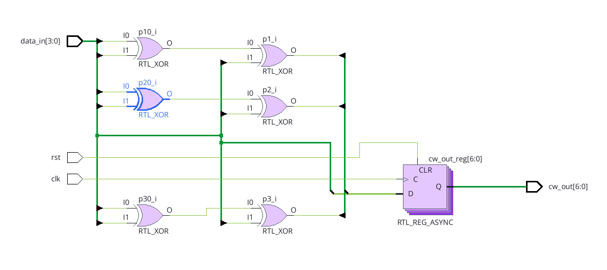
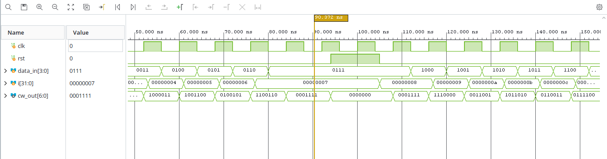
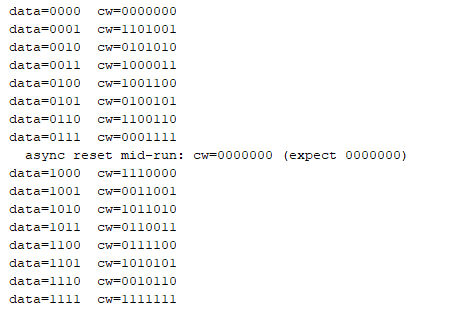

# EGCP 447 Hamming (7,4) Project Conventions

## Bit ordering

| Signal | Width | Layout (MSB to LSB) | Notes |
|---|---|---|---|
| data | [3:0] | d1 d2 d3 d4 | d1 = data[3], d4 = data[0] |
| codeword | [6:0] | p1 p2 d1 p3 d2 d3 d4 | Position k (1 to 7, left to right) is bit 7 − k. Position 1 = cw[6], position 7 = cw[0]. |
| err_mask | [6:0] | Same order as the codeword | A 1 flips that position. 0000100 flips position 5 (d2). |
| syndrome | [2:0] | s3 s2 s1 | Its binary value is the error position. 000 means no error. |

## Equations

**Parity bits (encoder, even parity):**

- p1 = d1 ⊕ d2 ⊕ d4 (covers positions 1, 3, 5, 7)
- p2 = d1 ⊕ d3 ⊕ d4 (covers positions 2, 3, 6, 7)
- p3 = d2 ⊕ d3 ⊕ d4 (covers positions 4, 5, 6, 7)

**Syndrome (decoder, on received bits c1 to c7):**

- s1 = c1 ⊕ c3 ⊕ c5 ⊕ c7
- s2 = c2 ⊕ c3 ⊕ c6 ⊕ c7
- s3 = c4 ⊕ c5 ⊕ c6 ⊕ c7

The decoder flips the bit at position {s3 s2 s1}, then reads data from positions 3, 5, 6 and 7.

## Module interfaces

| Module | Inputs | Outputs |
|---|---|---|
| hamming_encoder | clk, rst, data_in[3:0] | cw_out[6:0] |
| hamming_decoder | clk, rst, cw_in[6:0] (codeword = cw) | data_out[3:0], corrected, syndrome[2:0] |
| hamming_system | clk, rst, data_in[3:0], err_mask[6:0] | tx_cw[6:0], rx_cw[6:0], data_out[3:0], corrected, syndrome[2:0] |
| hamming_top | clk, sw[1:0], btn[3:0] | led[3:0], led4_r, led4_g, led4_b |

## Timing and reset

- All outputs are registered on the rising edge of clk.
- rst is asynchronous and active-high in the encoder and decoder. It must be shown working in simulation.
- On the board, rst is tied to 0 in hamming_top (the handout allows this).
- Latency from data_in to data_out is 2 clock cycles. Testbenches must wait at least that long before checking.
- Board clock is 125 MHz (8 ns period).

## Corrected flag

corrected is 1 only when the syndrome points at a data position (3, 5, 6 or 7). For a parity-bit error at position 1, 2 or 4, the bit is still fixed but corrected stays 0.

## Board mapping

| Board part | Signal | Expected result |
|---|---|---|
| SW0, SW1 | data[0], data[1] | Data input |
| BTN0, BTN1 | data[2], data[3] | Data input, 1 while pressed |
| BTN2 | err_mask = 1000000 | Flips position 1 (p1). RGB shows red (syndrome 001). |
| BTN3 | err_mask = 0000100 | Flips position 5 (d2). RGB shows magenta (syndrome 101). |
| LED0 to LED3 | data_out[0] to data_out[3] | Always match the input for zero or one error |
| RGB LED4 | red = s1, green = s2, blue = s3 | Off when there is no error |

## Encoder results

### RTL schematic

Vivado's elaborated design for `hamming_encoder`: each 3-input parity XOR becomes two 2-input XOR gates, feeding a 7-bit register with asynchronous clear (`RTL_REG_ASYNC`).

### Simulation waveform

`tb_hamming_encoder` steps `data_in` through all 16 values. At about 94 ns, `rst` is asserted between clock edges while `data_in = 0111`, and `cw_out` clears from `0001111` to `0000000` immediately, confirming the reset is asynchronous. After `rst` is released, the encoder resumes normal operation.

### Tcl console output

All 16 codewords match the Hamming (7,4) table, and the mid-run reset check reads `0000000`.

## References

- [Hamming(7,4), Wikipedia](https://en.wikipedia.org/wiki/Hamming(7,4))
- [Hamming code, Michael Dipperstein](https://michaeldipperstein.github.io/hamming.html)
- [Verilog operators, ChipVerify](https://chipverify.com/verilog/verilog-operators)