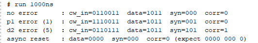
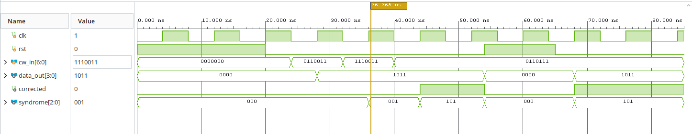
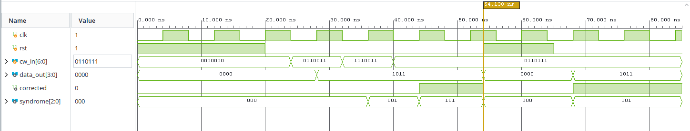
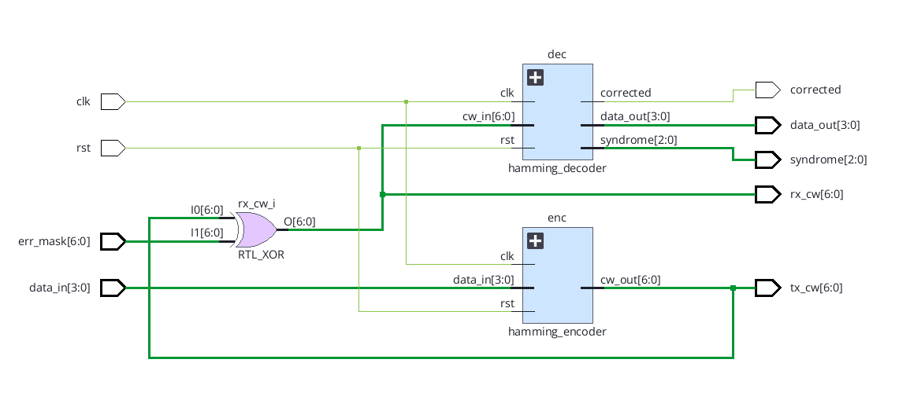
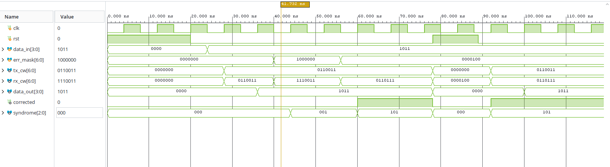
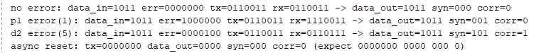
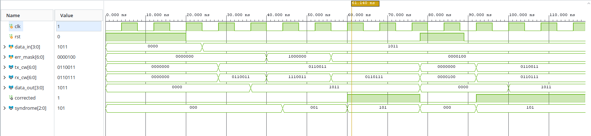
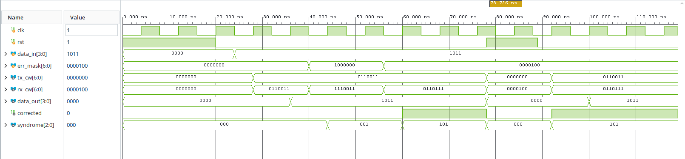
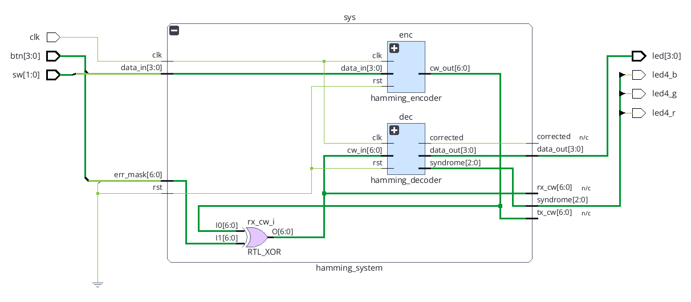
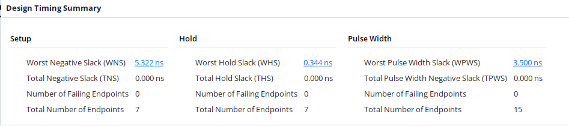

# EGCP 447 Hamming (7,4) Project Conventions

**Target board:** Digilent Arty Z7-10 (part `xc7z010clg400-1`)

## Bit ordering

| Signal | Width | Layout (MSB to LSB) | Notes |
|---|---|---|---|
| data | [3:0] | d1 d2 d3 d4 | d1 = data[3], d4 = data[0] |
| codeword | [6:0] | p1 p2 d1 p3 d2 d3 d4 | Position k (1 to 7, left to right) is bit 7 − k. Position 1 = cw[6], position 7 = cw[0]. |
| err_mask | [6:0] | Same order as the codeword | A 1 flips that position. 0000100 flips position 5 (d2). |
| syndrome | [2:0] | s3 s2 s1 | Its binary value is the error position. 000 means no error. |

## Equations

**Parity bits (encoder, even parity):**

- p1 = d1 ⊕ d2 ⊕ d4 (covers positions 1, 3, 5, 7)
- p2 = d1 ⊕ d3 ⊕ d4 (covers positions 2, 3, 6, 7)
- p3 = d2 ⊕ d3 ⊕ d4 (covers positions 4, 5, 6, 7)

**Syndrome (decoder, on received bits c1 to c7):**

- s1 = c1 ⊕ c3 ⊕ c5 ⊕ c7
- s2 = c2 ⊕ c3 ⊕ c6 ⊕ c7
- s3 = c4 ⊕ c5 ⊕ c6 ⊕ c7

The decoder flips the bit at position {s3 s2 s1}, then reads data from positions 3, 5, 6 and 7.

## Module interfaces

| Module | Inputs | Outputs |
|---|---|---|
| hamming_encoder | clk, rst, data_in[3:0] | cw_out[6:0] |
| hamming_decoder | clk, rst, cw_in[6:0] (codeword = cw) | data_out[3:0], corrected, syndrome[2:0] |
| hamming_system | clk, rst, data_in[3:0], err_mask[6:0] | tx_cw[6:0], rx_cw[6:0], data_out[3:0], corrected, syndrome[2:0] |
| hamming_top | clk, sw[1:0], btn[3:0] | led[3:0], led4_r, led4_g, led4_b |

## Timing and reset

- All outputs are registered on the rising edge of clk.
- rst is asynchronous and active-high in the encoder and decoder. It must be shown working in simulation.
- On the board, rst is tied to 0 in hamming_top (the handout allows this).
- Latency from data_in to data_out is 2 clock cycles. Testbenches must wait at least that long before checking.
- Board clock is 125 MHz (8 ns period).

## Corrected flag

corrected is 1 only when the syndrome points at a data position (3, 5, 6 or 7). For a parity-bit error at position 1, 2 or 4, the bit is still fixed but corrected stays 0.

## Board mapping

| Board part | Signal | Expected result |
|---|---|---|
| SW0, SW1 | data[0], data[1] | Data input |
| BTN0, BTN1 | data[2], data[3] | Data input, 1 while pressed |
| BTN2 | err_mask = 1000000 | Flips position 1 (p1). RGB shows red (syndrome 001). |
| BTN3 | err_mask = 0000100 | Flips position 5 (d2). RGB shows magenta (syndrome 101). |
| LED0 to LED3 | data_out[0] to data_out[3] | Always match the input for zero or one error |
| RGB LED4 | red = s1, green = s2, blue = s3 | Off when there is no error |

## Encoder results

### RTL schematic

Vivado's elaborated design for `hamming_encoder`: each 3-input parity XOR becomes two 2-input XOR gates, feeding a 7-bit register with asynchronous clear (`RTL_REG_ASYNC`).

### Simulation waveform

`tb_hamming_encoder` steps `data_in` through all 16 values. At about 94 ns, `rst` is asserted between clock edges while `data_in = 0111`, and `cw_out` clears from `0001111` to `0000000` immediately, confirming the reset is asynchronous. After `rst` is released, the encoder resumes normal operation.

### Tcl console output

All 16 codewords match the Hamming (7,4) table, and the mid-run reset check reads `0000000`.

## Decoder results

All decoder tests use data `1011`, whose codeword is `0110011`.

| Test | cw_in | data_out | syndrome | corrected |
|---|---|---|---|---|
| No error | 0110011 | 1011 | 000 | 0 |
| Parity-bit error, position 1 (p1) | 1110011 | 1011 | 001 | 0 |
| Data-bit error, position 5 (d2) | 0110111 | 1011 | 101 | 1 |
| Async reset between clock edges | 0110111 | 0000 | 000 | 0 |

### Tcl console output

Both single-bit errors are corrected back to `1011`. The syndrome names the flipped position, and `corrected` is high only for the data-bit error.

### Parity-bit error

At about 36 ns the decoder receives `1110011` (p1 flipped). `data_out` stays `1011`, `syndrome` reads `001`, and `corrected` stays `0` because no data bit was damaged. At about 44 ns the d2 error (`0110111`) gives `syndrome = 101` and `corrected = 1`.

### Asynchronous reset

At about 54 ns `rst` is asserted between clock edges, and `data_out`, `syndrome` and `corrected` clear to zero immediately. After `rst` is released, the decoder corrects the d2 error again on the next clock edge.

## System results

### RTL schematic

`hamming_system` connects the two modules through the error-injection XOR. The encoder's `cw_out` drives `tx_cw`, which feeds the XOR together with `err_mask`. The XOR output is `rx_cw`, and it goes into the decoder's `cw_in`. `clk` and `rst` are shared by both modules, and `tx_cw` and `rx_cw` are brought out as ports so both codewords can be viewed in simulation.

### End-to-end simulation

`tb_hamming_system` sends data `1011` through encoder, error XOR and decoder. Data passes through two registers, so `data_out` follows `data_in` two clock cycles later.

| Time | err_mask | tx_cw | rx_cw | data_out | syndrome | corrected |
|---|---|---|---|---|---|---|
| ~36 ns | 0000000 (no error) | 0110011 | 0110011 | 1011 | 000 | 0 |
| ~44 ns | 1000000 (flip p1) | 0110011 | 1110011 | 1011 | 001 | 0 |
| ~60 ns | 0000100 (flip d2) | 0110011 | 0110111 | 1011 | 101 | 1 |
| ~78 ns | rst asserted mid-cycle | 0000000 | 0000100 | 0000 | 000 | 0 |

`tx_cw` stays at the clean codeword while `rx_cw` shows each injected bit flip, and `data_out` stays `1011`: the single-bit error is corrected end to end. `corrected` is low for the parity-bit error and high for the data-bit error. When `rst` is asserted between clock edges, both the encoder and decoder outputs clear immediately; `rx_cw` reads `0000100` during reset because the XOR is combinational and still applies the mask. After reset is released, the pipeline refills and `data_out` returns to `1011`.

### Tcl console output

### Data-bit error corrected

Cursor at about 61 ns: `err_mask = 0000100` flips d2, so `rx_cw = 0110111`. The decoder reports `syndrome = 101` and `corrected = 1`, and `data_out` is still `1011`.

### Asynchronous reset

Cursor at about 79 ns: `rst` is high between clock edges, and `tx_cw`, `data_out`, `syndrome` and `corrected` are already zero. `rx_cw` reads `0000100` because the mask is still applied to the cleared codeword.

## Top level (Arty Z7)

### RTL schematic

`hamming_top` connects the board pins to `hamming_system`. `btn[1:0]` and `sw[1:0]` form `data_in`, and `btn[2]` and `btn[3]` form `err_mask` (positions 1 and 5). `rst` is tied to ground, since the board has no spare reset button. `data_out` drives `led[3:0]`, and the three syndrome bits drive `led4_r`, `led4_g` and `led4_b`. `corrected`, `tx_cw` and `rx_cw` are marked n/c (not connected) because they are used only in simulation.

### Timing

After implementation on the Arty Z7-10 (`xc7z010clg400-1`), the design meets the 125 MHz (8 ns) clock with margin: worst negative slack is 5.322 ns, worst hold slack is 0.344 ns, and there are no failing endpoints. The slowest register-to-register path takes about 2.7 ns of the 8 ns period.

## References

- [Hamming(7,4), Wikipedia](https://en.wikipedia.org/wiki/Hamming(7,4))
- [Hamming code, Michael Dipperstein](https://michaeldipperstein.github.io/hamming.html)
- [Verilog operators, ChipVerify](https://chipverify.com/verilog/verilog-operators)